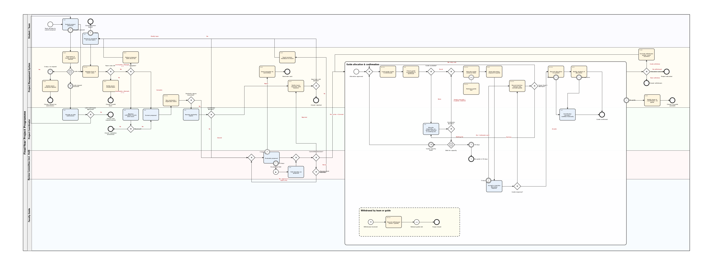

# Student Project Approval & Allocation System (BPMN 2.0 · Camunda 8)

A BPMN 2.0 model of a final-year project programme, built for **Camunda 8 (Zeebe)**. A student team submits a proposal. The proposal is validated, screened, checked for duplicates and reviewed by a committee. After approval a faculty guide is allocated and confirms. The model covers the happy path and 13 failure paths, each with a solution drawn in the diagram.



> The PNG is a preview drawn from the same coordinates as the `.bpmn` file. Open the `.bpmn` in Camunda Modeler for the real notation.

## Repository layout

```
.
├── bpmn/student-project-allocation.bpmn   # executable process (Camunda 8 / Zeebe)
├── dmn/guide-allocation.dmn               # business rule: guide eligibility and selection
├── docs/process-diagram.png               # preview image
├── docs/failure-path-register.csv         # failure register in spreadsheet form
└── samples/
    ├── start-instance.json                # variables to start a test instance
    └── dmn-test-cases.json                # expected outcomes for the DMN rule
```

## Quick start

1. Install [Camunda Modeler](https://camunda.com/download/modeler/) (Desktop) and choose **Camunda 8** as the target.
2. Open `bpmn/student-project-allocation.bpmn` and `dmn/guide-allocation.dmn`.
3. Connect to a cluster (Camunda 8 SaaS, or a local Camunda 8 Run), then use **Deploy**. Deploy the DMN **together with or before** the BPMN, because the business rule task refers to decision `allocationResult`.
4. Start the development workers from `workers/` before starting a process instance (see `workers/README.md`).
5. Start an instance with the variables from `samples/start-instance.json`. The sample includes the fields required by the validation worker.
6. Complete user tasks in Tasklist. The repository now includes development workers, but notifications are console-only and persistence is not connected to a database.

Target version: **Camunda 8.7**. The model uses native user tasks, a business rule task with a called decision, escalation, error and compensation events, and a message event sub-process.

## Scope

| | |
|---|---|
| **Starts when** | A student team decides to submit a project proposal. |
| **Ends when** | A guide is allocated and confirmed, or the case is closed as rejected / lapsed / withdrawn. |
| **Pool and lanes** | Final-Year Project Programme: Student / Team, Project Management System, Project Coordinator, Review Committee (incl. HoD), Faculty Guide. |

The system lane holds all automated work. The allocation sub-process is drawn across the lanes so that each step sits with its actor.

## Happy path

| # | Step | Element | Type |
|---|------|---------|------|
| 1 | Team submits the proposal | `Task_Submit` | User task |
| 2 | Validate form and team rules | `Task_Validate` | Service task |
| 3 | Coordinator screens the proposal | `Task_Screen` | User task |
| 4 | Similarity / duplicate-topic check | `Task_Similarity` | Service task |
| 5 | Committee evaluates, then decides | `Task_Review` → `Gw_Decision` | User task + exclusive gateway |
| 6 | Check guide availability and workload | `A_Rule` | Business rule task (DMN) |
| 7 | Allocate guide (reserve slot) | `A_Reserve` | Service task |
| 8 | Send allocation request | `A_SendReq` | Send task |
| 9 | Guide accepts | `A_Wait` | User task |
| 10 | Record allocation | `A_Record` | Service task |
| 11 | Notify student | `A_Notify` | Send task |
| 12 | End: project allocated | `End_OK` | End event |

Steps 6 to 11 sit inside the sub-process `Sub_Allocation`.

## Failure Path Register

The first column is the failure ID. IDs also appear in the `<documentation>` text of the elements in the BPMN file. F1 to F11 follow the failure areas in the assignment. F12 and F13 are additional.

| ID | Failure point | Cause / trigger | Solution in the diagram | BPMN constructs | Elements |
|----|---------------|-----------------|-------------------------|-----------------|----------|
| **F1** | Proposal validation | Missing fields, no abstract, invalid roll numbers | Return proposal with error list and let the team resubmit. Counter `validationAttempts` allows 2 resubmissions. After that the coordinator resolves the case, or it is closed as unresolved. | Exclusive gateway, loop with counter limit, escalation to a user task | `Gw_Form`, `Task_ReturnErrors`, `Task_Revise`, `Task_CoordResolve`, `Gw_Resolved`, `End_Unresolved` |
| **F2** | Team rule check | Team too large, or a student already in another team | Notify the team and close the case. The team reforms and files a new proposal. | Exclusive gateway, send task, named end event | `Gw_Team`, `Task_NotifyInvalid`, `End_InvalidTeam` |
| **F3** | Duplicate / plagiarised topic | `similarityScore` above `similarityThreshold` | Coordinator reviews the match and records one of three outcomes: modify topic (loop back to the team), reject, or cleared (continue to the committee). | Exclusive gateways, user task, loop | `Gw_Sim`, `Task_SimReview`, `Gw_SimDec` |
| **F4** | Proposal deadline | Team does not submit in time | Interrupting timer (14 days) on the submission task. The team is flagged and notified. An event-based gateway waits for a late request message or a 3-day timer. The coordinator then approves (back to submission) or denies. | Timer boundary event, event-based gateway, message and timer catch events | `Boundary_Deadline`, `Task_FlagLate`, `Gw_Late`, `Catch_LateMsg`, `Catch_LateTimer`, `Task_LateDecide`, `Gw_LateDec` |
| **F5** | Committee asks for revision | Scope too large, vague objective, weak novelty | Revision feedback is sent and the team reworks (7-day timer). `revisionCycles` is capped at 2. After that the gateway sends the case back to the committee, which may only approve or reject. | Exclusive gateways, loop with counter limit, timer boundary event | `Gw_Decision`, `Gw_Limit`, `Task_SendRevision`, `Task_Revise`, `Gw_JoinReview` |
| **F6** | Committee rejects | Not feasible, out of syllabus, lacks resources | Send the reasons. One new topic is allowed (`newTopicAllowance`) and loops back to submission. A second rejection ends as Rejected. | Exclusive gateway, counter, loop | `Task_NotifyReject`, `Gw_NewTopic`, `End_Rejected` |
| **F7** | Review delayed | Committee misses the SLA | Non-interrupting timer (5 days) sends a reminder. Interrupting timer (10 days) throws an escalation and the HoD decides. | Non-interrupting and interrupting timer boundary events, escalation throw event | `Boundary_Reminder`, `Task_Reminder`, `Boundary_Escalate`, `Throw_Escalate`, `Task_HoD` |
| **F8** | No guide available | Domain mismatch, or all matching guides at maximum load | The rule returns `NONE`. The coordinator allocates manually, adds a co-guide or external guide, or puts the team on a waiting list. A waiting team resumes when a *guide-capacity-freed* message arrives. After 30 days the sub-process throws `NO_GUIDE_AVAILABLE`, which is caught on the sub-process boundary and the case closes. | Business rule task, exclusive gateway, event-based gateway, error end event and error boundary event | `A_Gw1`, `A_NoneFound`, `A_Gw2`, `A_GwWait`, `A_CatchCap`, `A_CatchTimer`, `A_EndNoGuide`, `Boundary_NoGuide` |
| **F9** | Guide declines or is silent | Workload, conflict of interest, no reply | A 5-day timer on the guide's task is treated as a decline. The decline task releases the slot, adds the guide to `excludedGuides` and counts the attempt. The rule is rerun (up to 3 attempts). After that the coordinator allocates manually. | Timer boundary event, loop with counter limit, DMN exclusion list | `A_BoundaryTimer`, `A_Gw4`, `A_Decline`, `A_Gw5` |
| **F10** | Notification / system failure | E-mail service down, database write error | `retries="3"` on the record and notify jobs. When retries are exhausted the worker throws `DB_WRITE_ERROR` or `NOTIFICATION_FAILED`. An error boundary event routes to the coordinator, who completes the step manually. | Error boundary events, job retries, user task fallback | `A_Record`, `A_BoundaryDb`, `A_Notify`, `A_BoundaryNotify`, `A_Manual` |
| **F11** | Withdrawal after approval | Team dissolves, or guide goes on leave | A message event sub-process inside the allocation scope records who withdrew, then throws compensation, which runs `A_Release` and frees the guide slot. A gateway after the sub-process sends a **guide** withdrawal back to the allocation step (the guide is excluded and counters reset) and closes the case on a **team** withdrawal. | Message event sub-process, compensation boundary event + handler, compensation throw event, exclusive gateway, loop | `Esub_Withdraw`, `A_BoundaryComp`, `A_Release`, `Gw_After`, `Task_Prep`, `End_Withdrawn` |
| **F12** | Rework never comes back | Team does not resubmit within 7 days | Interrupting 7-day timer on the rework task closes the case. | Timer boundary event | `Boundary_ReviseTimer`, `End_LapsedRevise` |
| **F13** | Late request ignored or denied | No message within 3 days, or coordinator says no | Both branches end with a notice and a distinct end state. | Event-based gateway, exclusive gateway | `Catch_LateTimer`, `Task_NotifyLapse`, `End_Lapsed`, `End_LateDenied` |

## Why these task types

| Task | Type | Reason |
|------|------|--------|
| Submit, revise, screen, review, HoD decision, guide response, coordinator tasks | **User task** | A person must act and provide data. Assigned by `candidateGroups`, so each lane maps to a group. |
| Validate, similarity check, load roster, reserve slot, record allocation, record decline | **Service task** | Fully automated work done by a job worker. |
| Return errors, notify team, reminders, request to guide, notify student | **Send task** | One-way message with no wait. Keeps notification logic separate from business logic and makes F10 retries easy to place. |
| Check guide availability and workload | **Business rule task (DMN)** | Policy that changes over time (domains, load limits). Lives in a decision table and not in the diagram. |
| Exclude withdrawn guide, reset counters | **Script task** | Pure variable work (FEEL), no worker needed. |

## Why these gateways

| Gateway | Type | Reason |
|---------|------|--------|
| Team rules OK?, Form complete?, Similarity above threshold?, Committee decision?, Revision limit, New topic allowed?, Guide available?, Guide response?, Attempts left?, Allocation outcome? | **Exclusive** | Exactly one outcome per decision. Every split has a `default` flow so a token is never stuck. |
| Join before review, join before decision, join before allocation steps | **Exclusive (merge)** | Merges alternative paths into one. No parallel branches exist here, so no parallel gateway is used. |
| Late request?, Wait for capacity | **Event-based** | The process waits for whichever comes first: a message or a timer. |

The process has no parallel work, so it uses no parallel gateway. Inclusive gateways were not needed either, because every decision has exactly one outcome.

## Process variables

| Variable | Set by | Used for |
|----------|--------|----------|
| `proposalId`, `teamId`, `proposalDomain`, `guides` | Start variables | Message correlation, DMN input |
| `formValid`, `teamValid`, `errorList` | `validate-proposal` worker | F1, F2 |
| `similarityScore`, `similarityThreshold` (0.4) | `similarity-check` worker, start event | F3 |
| `simDecision` (`modify` / `reject` / `cleared`) | Coordinator form | F3 |
| `decision` (`approved` / `revise` / `rejected`) | Committee and HoD form | Main decision |
| `validationAttempts`, `revisionCycles`, `newTopicAllowance`, `guideAttempts` | Output mappings | Loop limits (F1, F5, F6, F9) |
| `allocation` (`status`, `guideId`) | DMN, or coordinator form | F8, F9 |
| `coordDecision` (`assign` / `waitlist`) | Coordinator form | F8 |
| `guideResponse` (`accept` / `decline`) | Guide form | F9 |
| `excludedGuides` | Decline and prepare tasks | DMN exclusion |
| `withdrawalSource` → `withdrawalBy` | Message payload, record task | F11 |
| `lateApproved`, `resolved` | Coordinator forms | F4, F1 |

## Job workers and error codes

| Job type | Used by |
|----------|---------|
| `validate-proposal`, `similarity-check`, `load-guide-roster` | Validation and allocation preparation |
| `reserve-guide-slot`, `release-guide-slot` | Reserve and compensation handler |
| `record-guide-decline`, `record-allocation`, `record-withdrawal` | Allocation records |
| `send-notification` | All send tasks |

| Error / escalation code | Thrown by | Caught by |
|-------------------------|-----------|-----------|
| `DB_WRITE_ERROR` | `record-allocation` worker after 3 retries | `A_BoundaryDb` |
| `NOTIFICATION_FAILED` | `send-notification` worker (allocation notice) after 3 retries | `A_BoundaryNotify` |
| `NO_GUIDE_AVAILABLE` | `A_EndNoGuide` | `Boundary_NoGuide` |
| `REVIEW_SLA_BREACH` | `Throw_Escalate` | Informational escalation (no catcher, the flow continues to the HoD) |

| Message | Correlation key | Purpose |
|---------|-----------------|---------|
| `late-submission-request` | `proposalId` | F4 |
| `guide-capacity-freed` | `proposalDomain` | F8 |
| `project-withdrawal` (payload `withdrawalSource` = `team` or `guide`) | `proposalId` | F11 |

| Timer | Duration |
|-------|----------|
| Submission window | `P14D` |
| Late-request wait | `P3D` |
| Rework window | `P7D` |
| Review reminder / escalation | `P5D` / `P10D` |
| Guide response | `P5D` |
| Waiting list | `P30D` |

## Design decisions and limits

- **Shared rework task.** `Task_Revise` serves F1, F3, F5 and F6. Any rework goes back through validation and the similarity check, so a changed topic is always re-checked.
- **F2 end state.** The assignment suggests an error end event. In a top-level process an uncaught BPMN error raises an incident in Camunda 8, so `End_InvalidTeam` is a named end event instead. The error end event is used where it is caught (`A_EndNoGuide`).
- **F11 uses an event sub-process,** not a boundary event on the sub-process. A boundary event would terminate the scope before compensation could run. The event sub-process keeps the scope alive long enough for the compensation throw to release the guide slot. The behaviour is the same for the user: an interrupting message ends the allocation attempt.
- **Withdrawal is covered while the allocation sub-process is active.** Once the guide is confirmed the process ends. Withdrawals after that would belong to a separate project-tracking process.
- **Manual allocation** (F8, F9) goes through the same reserve, request and accept steps, so the guide still has to confirm.
- **Forms are not embedded in the BPMN.** User tasks rely on Tasklist variable entry/completion; for a polished production experience, attach forms or build a task application.
- **Development workers are included under `workers/`.** They make the process executable for a local demo, but notification tasks only log to the console, and allocation persistence is represented by process variables rather than a database. Replace these adapters before production use.
- **A live engine deployment has not been run from this package.** Validate against the exact Camunda 8.7 runtime you use.

## Validation status

The BPMN and DMN are checked for well-formed XML and static model consistency. The compensation boundary event is interrupting (`cancelActivity="true"`) because Camunda rejects a non-interrupting compensation boundary event. Static checks do not prove runtime correctness: deploy both BPMN and DMN, run the worker process, and test the scenarios in `docs/AUDIT_REPORT.md` against your exact Camunda 8.7 runtime. The local demo workers are not production integrations.

## Evaluation rubric mapping

| Criterion | Where to look |
|-----------|---------------|
| Happy path | [Happy path](#happy-path) and the main row of the diagram |
| Task types | [Why these task types](#why-these-task-types) |
| Gateways | [Why these gateways](#why-these-gateways) |
| Failure identification | [Failure Path Register](#failure-path-register), F1 to F13 |
| Solutions | Same table, the constructs column |
| Notation and readability | Lanes, one allocation sub-process, one event sub-process, named flows and end states |

## License

MIT. See `LICENSE`.
